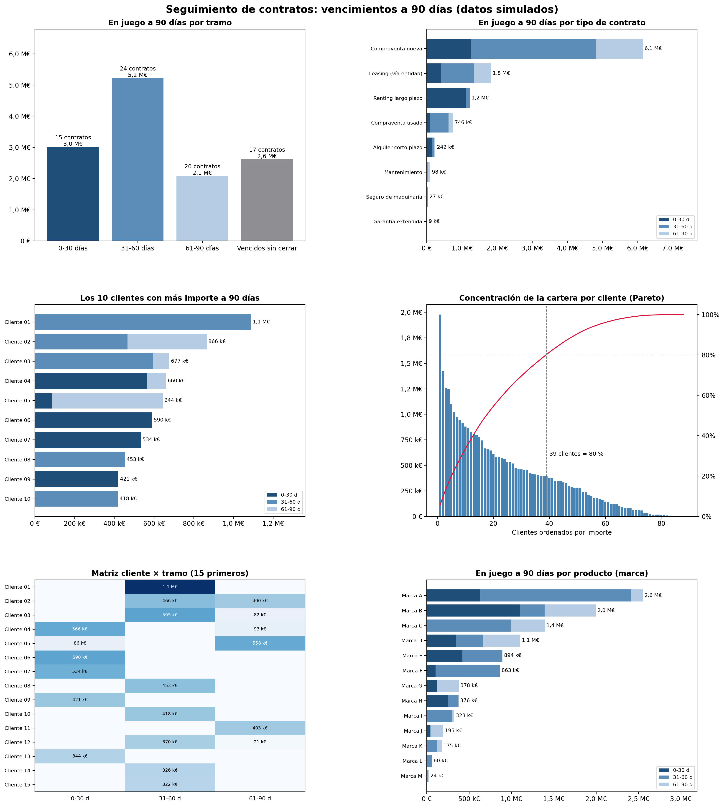

# Panel de seguimiento de contratos

**Proyecto profesional** · Python aplicado a la gestión comercial

> El demo usa una base de contratos ficticia, creada para mostrar el funcionamiento del panel.

## Problema
El área comercial necesita saber qué contratos vencen pronto, a qué clientes contactar primero y dónde se concentra el riesgo de la cartera, sin revisar a mano una base de cientos de contratos.

## Solución
Un proceso en Python que toma la base de contratos y genera un **panel interactivo en HTML** con:
- **Tablero**: vencimientos a 30, 60 y 90 días, concentración por cliente (Pareto), matriz cliente × tramo y apertura por tipo de contrato y producto.
- **Alertas**: contratos con preaviso superado, vencidos sin cerrar, renegociaciones y cancelaciones recientes.
- **Control de calidad**: detecta inconsistencias en la base de origen, como nombres de clientes escritos de distintas formas.

## Herramientas
Python · pandas · Matplotlib · HTML/CSS

🔗 [Ver el panel en vivo (GitHub Pages)](https://sabrinita81.github.io/My-projects-Data/04-panel-seguimiento-contratos/panel_seguimiento_contratos_demo.html)
